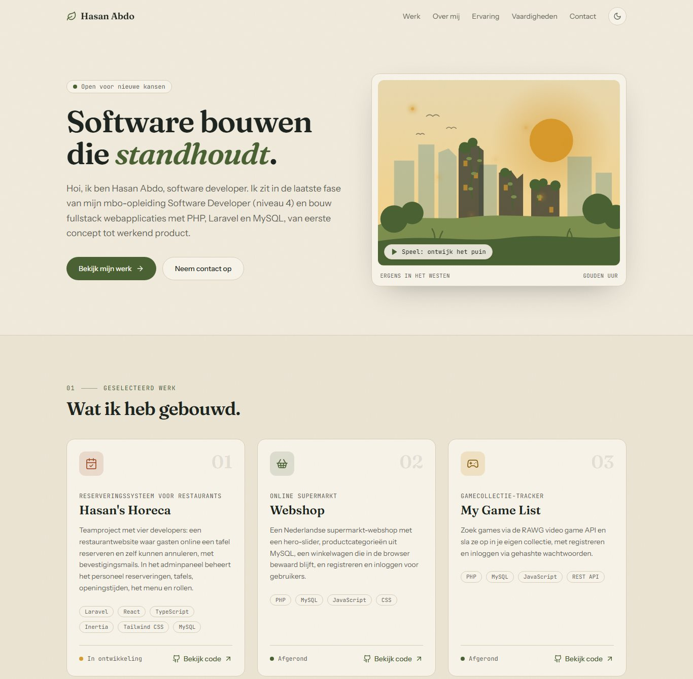

# Portfolio – Hasan Abdo

Mijn persoonlijke portfolio als software developer. Ik zit in de laatste fase
van mijn mbo-opleiding Software Developer (niveau 4) aan het Alfa-college.

**Live bekijken:** https://hasazaro.github.io/



## Wat staat erop

- **Projecten:** onder andere _Hasan's Horeca_, een reserveringssysteem voor
  restaurants dat ik in een team van vier heb gebouwd, een webshop en een
  gamecollectie-tracker.
- **Over mij:** wie ik ben en hoe ik werk.
- **Ervaring en opleiding:** mijn stage bij Afosto, vrijwilligerswerk bij De
  Jonge Onderzoekers en mijn opleiding aan het Alfa-college.
- **Vaardigheden en contact.**
- Een klein spel in de hero-afbeelding: ontwijk het puin.

## Gebouwd met

- Laravel 13 en PHP 8.4
- React 19, TypeScript en Inertia
- Tailwind CSS 4
- Vite

## Lokaal draaien

Je hebt PHP 8.4, Composer en Node.js nodig.

```bash
composer setup     # installeert alles, maakt .env aan en draait de migraties
composer run dev   # start Laravel en Vite
```

Open daarna de URL die in de terminal verschijnt.

## Teksten aanpassen

Alle persoonlijke inhoud (profiel, projecten, ervaring, vaardigheden) staat in
[`resources/js/data/portfolio.ts`](resources/js/data/portfolio.ts).

## Publiceren op GitHub Pages

GitHub Pages kan geen PHP draaien, daarom is er ook een statische versie van de
portfoliopagina. Bij elke push naar `main` bouwt de workflow
[`.github/workflows/pages.yml`](.github/workflows/pages.yml) die versie en zet
hem online.

Zelf de statische versie bouwen:

```bash
npm run build:pages   # resultaat staat in dist-pages/
```
